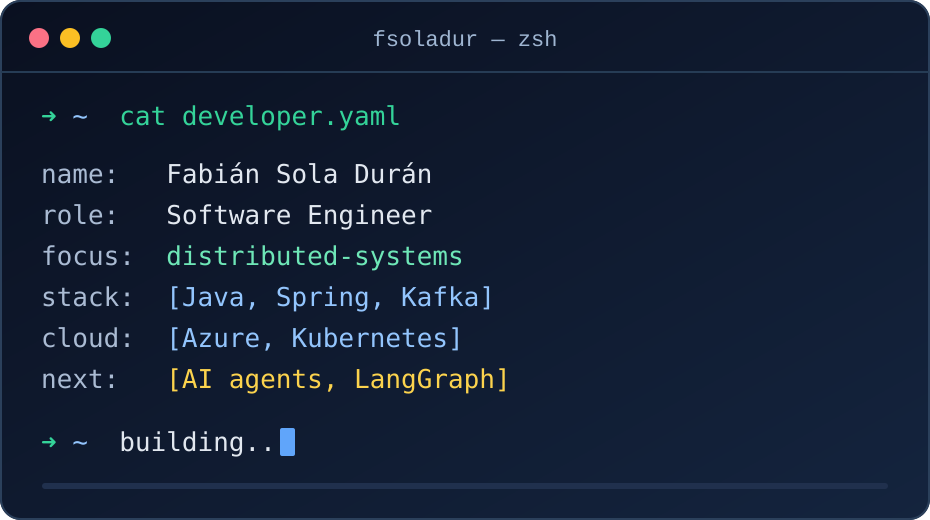

<!-- GitHub supports a safe subset of HTML in Markdown, plus SVG animations via . -->

  
    
  
    
  
  
  

 

<h2>About me</h2>

<table>
  <tr>
    <td valign="top" width="54%">
      
I'm a <strong>Software Engineer</strong> based in Spain, focused on building reliable backend services and cloud-native systems.

      
My professional work centers on <strong>Java, Spring Boot, Apache Kafka, event-driven microservices, API-first development, observability, and Azure Kubernetes Service (AKS)</strong>.

      
I'm also pursuing an <strong>MSc in Software Engineering</strong> at the University of Murcia and exploring AI agents for developer tooling and database migration.

      
<strong>What I care about:</strong> clean boundaries, distributed systems, automated testing, security and shipping maintainable software.

    </td>
    <td valign="top" width="46%">
      
    </td>
  </tr>
</table>

<h2>Tech stack</h2>

<table>
  <tr>
    <td width="27%"><strong>Backend &amp; APIs</strong></td>
    <td><code>Java</code> <code>Spring Boot</code> <code>Spring Security</code> <code>REST</code> <code>OpenAPI</code> <code>Kafka</code> <code>RabbitMQ</code></td>
  </tr>
  <tr>
    <td><strong>Cloud &amp; DevOps</strong></td>
    <td><code>Docker</code> <code>Kubernetes</code> <code>Azure AKS</code> <code>Azure DevOps</code> <code>CI/CD</code> <code>OpenTelemetry</code></td>
  </tr>
  <tr>
    <td><strong>Data &amp; Quality</strong></td>
    <td><code>PostgreSQL</code> <code>MySQL</code> <code>MongoDB</code> <code>Redis</code> <code>JUnit 5</code> <code>Mockito</code> <code>Testcontainers</code></td>
  </tr>
  <tr>
    <td><strong>Projects &amp; AI</strong></td>
    <td><code>TypeScript</code> <code>NestJS</code> <code>LangChain</code> <code>LangGraph</code> <code>DeepAgents</code> <code>Spring AI</code></td>
  </tr>
</table>

Technologies listed under "Projects & AI" include project-based and learning experience, not necessarily professional production experience.

<h2>Featured projects</h2>

<table>
  <tr>
    <td valign="top" width="50%">
      <h3>🧠 <a href="https://github.com/modelum/LLMigrator-DB">LLMigrator-DB</a></h3>
      
My Bachelor's Thesis: an LLM-powered tool that assists with database schema migration, data migration, validation and application code migration.

      
<code>Java</code> <code>Spring Boot</code> <code>Spring AI</code> <code>OpenRouter</code>

      <a href="https://github.com/modelum/LLMigrator-DB">Explore repository →</a>
    </td>
    <td valign="top" width="50%">
      <h3>🤝 <a href="https://github.com/fsoladur/SolidarianID">SolidarianID</a></h3>
      
A social-impact platform for communities, causes and collaborative initiatives, built with a modular approach and modern web technologies.

      
<code>TypeScript</code> <code>NestJS</code> <code>React</code> <code>gRPC</code>

      <a href="https://github.com/fsoladur/SolidarianID">Explore repository →</a>
    </td>
  </tr>
</table>

<h2>Currently exploring</h2>

- AI-agent orchestration with LangChain, LangGraph and DeepAgents.
- Agent-based database migration and software engineering tools.
- Reliable distributed systems, API security, observability and software architecture.

  

  
<strong>Build thoughtfully. Test thoroughly. Keep improving.</strong>

  <a href="https://github.com/fsoladur?tab=repositories">Explore my repositories</a>

